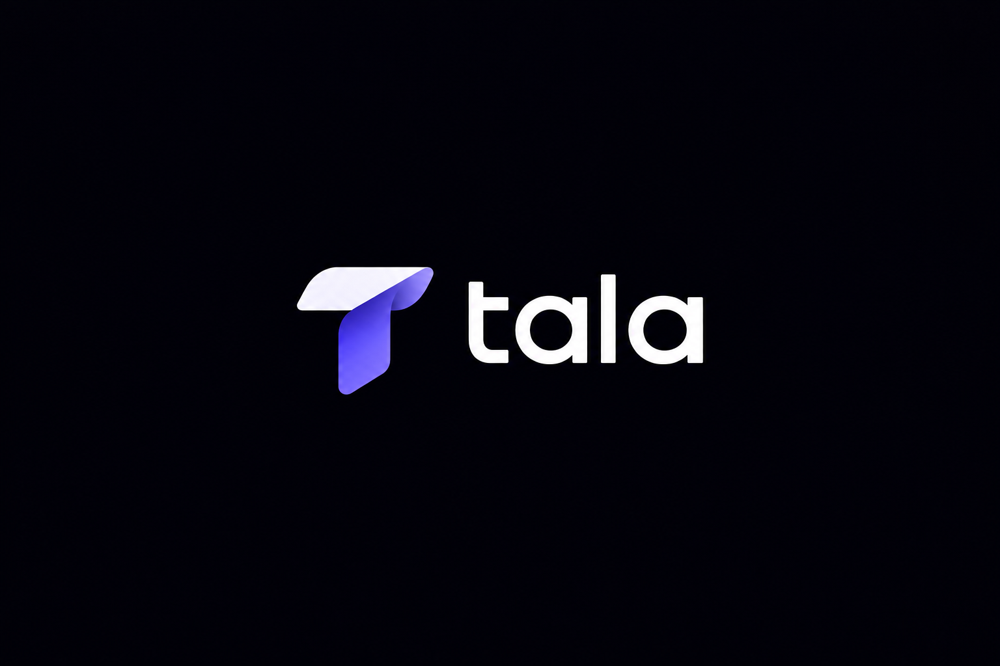

<p align="center">
  
</p>

# Tala

**Find your flow.**

[English](README.md) · [Bahasa Indonesia](README.id.md) · [Knowledge proyek](PROJECT.md)

[](https://github.com/arsyadal/tala/actions/workflows/ci.yml)

Tala adalah workspace terminal lokal untuk menjelajahi dan mengedit file proyek, menjalankan shell dan agen koding di beberapa tab atau split pane, serta bekerja dengan Git. Tala berjalan langsung di terminal tanpa browser, server, atau runtime Node.js. WSL adalah pilihan profil shell di Windows, bukan syarat instalasi.

**Status rilis:** Tala masih dalam pengembangan dan belum menerbitkan rilis bertag. Tabel di bawah menunjukkan platform yang ditargetkan. Lihat hasil terbaru di Native CI; rilis juga memerlukan pengujian manual di Windows, macOS, dan Linux.

## Mulai cepat

Pasang [Rust 1.88 atau lebih baru](https://rustup.rs/) dan linker native untuk platform yang kamu pakai. Jalankan Tala dari terminal interaktif. Pasang [Git](https://git-scm.com/downloads) untuk mengunduh repositori dan memakai panel Git.

```sh
git clone https://github.com/arsyadal/tala.git
cd tala
cargo run --locked -- .
```

Tekan `F5` untuk membuka shell, `Ctrl+Shift+P` untuk Command Palette, atau `Ctrl+P` untuk Quick Open file. Untuk berganti proyek, tekan `Ctrl+Shift+O` (folder terbaru atau ketik path), atau tekan `F2`, masuk ke folder tujuan, lalu tekan `o`.

Untuk memasang perintah `tala` dari source lokal:

```sh
cargo install --path . --locked
tala .
```

Berikan path folder sebagai argumen. Gunakan tanda kutip jika path mengandung spasi. Tanpa argumen, Tala membuka direktori saat ini.

## Platform target

| Platform | Arsitektur | Shell yang dideteksi Tala |
| --- | --- | --- |
| Windows dengan ConPTY | x64, ARM64 | PowerShell, Command Prompt, Git Bash, WSL |
| macOS | Intel, Apple Silicon | Bash, Zsh, Fish |
| Linux | x64, ARM64 | Bash, Zsh, Fish |

Shell harus tersedia di perangkat. Di Linux, clipboard sistem memerlukan sesi X11 atau compositor Wayland dengan dukungan data control.

## Kontrol

| Tombol | Aksi |
| --- | --- |
| `F1` | Buka bantuan. |
| `Ctrl+Shift+P` | Buka Command Palette (cari dan jalankan semua aksi). |
| `Ctrl+P` | Quick Open file di workspace aktif. |
| `Ctrl+Shift+O` | Ganti workspace dari folder terbaru atau ketik path. |
| `Ctrl+B` | Tampilkan atau sembunyikan sidebar. |
| `F2` | Panel Files: `↑`/`↓` pilih, `Enter` buka, `Backspace` naik, `o` jadikan workspace, `n` file baru, `N` folder baru, `R` rename, `d`/`Delete` hapus (dengan konfirmasi). |
| `F3` / `Ctrl+Shift+A` | Panel Launcher: `Enter` jalankan shell atau agen, `r` deteksi ulang `PATH`. |
| `F4` / `Ctrl+Shift+G` | Panel Git: `Enter` diff working tree, `d` diff staged, `s`/`u` stage/unstage, `c` commit, `f`/`p`/`P` fetch/pull/push, `b` branch, `S` stash push, `t` daftar/pop stash, `w` worktree, `r` refresh. |
| `F5` / `Ctrl+Shift+T` | Buka tab terminal baru. |
| `Ctrl+Shift+D` / `Ctrl+Shift+E` | Split terminal vertikal atau horizontal (hingga 4 pane per tab). |
| `Alt+Left` / `Alt+Right` | Pindah fokus antar split pane. |
| `F6` / `F7` | Pindah ke tab berikutnya, atau tutup pane/tab aktif. |
| `Ctrl+Shift+F` | Cari teks di layar dan scrollback terminal, lalu lompat ke hasilnya. |
| `F8` / `Ctrl+Shift+C` | Salin seleksi terminal, baris hasil pencarian, atau isi editor. |
| `F9` / `Ctrl+Shift+V` | Tempel dari clipboard sistem. |
| `F10` | Keluar dari Tala. |
| `Tab` / `Esc` di sidebar | Pindahkan fokus ke terminal atau sembunyikan sidebar. |
| `Ctrl+C` di sesi terminal | Interupsi program yang sedang berjalan. |
| `Shift+Page Up` / `Shift+Page Down` | Gulir riwayat terminal. |

Klik untuk berpindah tab, fokus ke split pane, atau memakai tombol panel. Seret kursor di atas teks terminal sebelum menyalin.

### Editor ringan

Membuka file UTF-8 (hingga 1 MiB) menampilkan pratinjau read-only dengan nomor baris dan syntax highlighting ringan. Tekan `e` untuk masuk mode edit, `Ctrl+S` untuk menyimpan, `F8` untuk menyalin seluruh isi, dan `Esc` untuk menutup (dengan konfirmasi jika ada perubahan yang belum disimpan).

### Agen koding

Pasang CLI dari penyedia sebelum menjalankannya di Tala.

| Agen | Executable |
| --- | --- |
| Codex (ChatGPT) | `codex` |
| Antigravity | `agy` |
| Oh My Pi (OMP) | `omp` |
| Pi | `pi` |

Kamu juga bisa menambahkan custom agent lewat `[[agents]]` di `config.toml`. Jalankan `tala --list-profiles` untuk melihat hasil deteksi. Agen berjalan dengan akun sistem operasi dan akses yang sama seperti di terminal biasa. Tala tidak mengisolasi agen atau menyimpan kredensialnya.

### Git

Panel Git mendukung status, diff, stage, unstage, commit, fetch, pull `--ff-only`, push, pindah dan buat branch lokal (`b`), stash push/list/pop (`S`/`t`), serta daftar/pindah worktree (`w`). Jika Git membutuhkan autentikasi interaktif, jalankan Git dari tab terminal.

## Konfigurasi

Jalankan `tala --config-path` untuk melihat lokasi persisnya. Buat `config.toml` di lokasi tersebut hanya jika ingin mengubah pengaturan bawaan:

```toml
# Opsional. Gunakan ID shell dari `tala --list-profiles`.
# default_shell = "zsh"
scrollback = 2000
mouse = true
# Pilihan tema: "dark", "light", "ocean", "forest"
theme = "dark"

# Opsional, contoh custom coding agent:
# [[agents]]
# id = "claude"
# label = "Claude Code"
# command = "claude"
# args = []
```

Daftar folder terbaru disimpan otomatis di `state.toml` pada direktori konfigurasi yang sama. Kunci yang tidak dikenal di `config.toml` akan memunculkan error saat Tala dibuka.

## Pengembangan dan rilis

```sh
cargo build --locked
cargo test --locked
```

[Native CI](.github/workflows/ci.yml) menjalankan build dan tes untuk keenam kombinasi OS dan arsitektur pada setiap pull request dan push ke `main`, termasuk tes clipboard desktop memakai display X11 virtual di Linux.

| Bagian | Source |
| --- | --- |
| Startup, input, dan state workspace | [`src/main.rs`](src/main.rs), [`src/app.rs`](src/app.rs), [`src/config.rs`](src/config.rs) |
| UI terminal, tema, sesi PTY, dan rendering VT | [`src/ui.rs`](src/ui.rs), [`src/theme.rs`](src/theme.rs), [`src/terminal.rs`](src/terminal.rs), [`src/terminal_view.rs`](src/terminal_view.rs) |
| Editor ringan, operasi file, dan Git native | [`src/editor.rs`](src/editor.rs), [`src/workspace.rs`](src/workspace.rs) |
| Validasi catatan rilis dan skrip instalasi Unix | [`scripts/release_notes.py`](scripts/release_notes.py), [`scripts/install.sh`](scripts/install.sh) |

### Versi dan checklist rilis

[Changelog](CHANGELOG.md) mencatat perubahan di bagian `Unreleased` sampai versinya terbit. `0.1.0` adalah rencana rilis pertama dan belum diterbitkan. Tala memakai [Semantic Versioning](https://semver.org/):

- Sebelum `1.0.0`, naikkan minor untuk fitur atau perubahan yang memutus kompatibilitas, dan patch untuk perbaikan kompatibel.
- Mulai `1.0.0`, naikkan major untuk perubahan yang memutus kompatibilitas, minor untuk fitur kompatibel, atau patch untuk perbaikan kompatibel.
- Gunakan tag `vMAJOR.MINOR.PATCH` dan validasi lokal dengan `python scripts/release_notes.py v0.1.0` (Python 3.11+).

Sebelum menjalankan [workflow Release](.github/workflows/release.yml), periksa hal berikut di Windows, macOS, dan Linux:

- [ ] Buka beberapa tab dan split pane, pindah tab/pane, ubah ukuran, jalankan dan interupsi perintah, lalu tutup sesi.
- [ ] Salin dan tempel teks Unicode memakai clipboard sistem.
- [ ] Buka folder berspasi, buat/edit/rename/hapus file uji, lalu pastikan sesi baru dimulai di workspace aktif.
- [ ] Cek diff, stage/unstage, commit, pindah branch, stash/pop, serta uji fetch, pull, dan push dengan remote uji.
- [ ] Deteksi dan jalankan setiap CLI agen pada platform yang didukung penyedianya. Catat kombinasi yang tidak tersedia.

[`scripts/install.sh`](scripts/install.sh) sudah disiapkan untuk Linux dan macOS setelah arsip rilis tersedia di [GitHub Releases](https://github.com/arsyadal/tala/releases). Homebrew, winget, dan paket crates.io masih direncanakan.

## Lisensi

Tersedia dengan lisensi ganda [MIT](LICENSE-MIT) atau [Apache-2.0](LICENSE-APACHE), sesuai pilihan pengguna.
