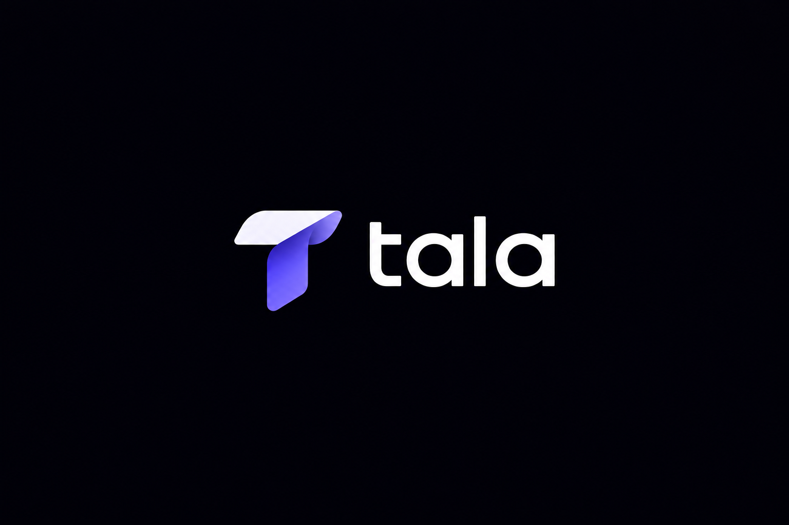

<p align="center">
  
</p>

# Tala

**Find your flow.**

[English](README.md) · [Bahasa Indonesia](README.id.md) · [Project knowledge](PROJECT.md)

[](https://github.com/arsyadal/tala/actions/workflows/ci.yml)

Tala is a local terminal workspace for browsing and editing project files, running shells and coding agents in tabs or split panes, and working with Git. It runs inside your terminal without a browser, server, or Node.js runtime. WSL is an optional shell profile on Windows, not a requirement.

**Release status:** Tala is in active development and has not published a tagged release yet. The matrix below describes the platforms the project targets. Check Native CI for current build results; a release also requires manual verification on Windows, macOS, and Linux.

## Quick start

Install [Rust 1.88 or newer](https://rustup.rs/) and a native linker for your platform. Run Tala from an interactive terminal. Install [Git](https://git-scm.com/downloads) to clone the repository and use the Git panel.

```sh
git clone https://github.com/arsyadal/tala.git
cd tala
cargo run --locked -- .
```

Press `F5` to open a shell, `Ctrl+Shift+P` for the Command Palette, or `Ctrl+P` for Quick Open. To switch projects, press `Ctrl+Shift+O` (recent workspaces or typed path), or press `F2`, navigate to a folder, and press `o`.

To install a `tala` command from this checkout:

```sh
cargo install --path . --locked
tala .
```

Pass a folder path to open it, quoting paths with spaces. If you omit the path, Tala opens the current directory.

## Target platforms

| Platform | Architectures | Shells Tala detects |
| --- | --- | --- |
| Windows with ConPTY | x64, ARM64 | PowerShell, Command Prompt, Git Bash, WSL |
| macOS | Intel, Apple Silicon | Bash, Zsh, Fish |
| Linux | x64, ARM64 | Bash, Zsh, Fish |

Shells must be available on the machine. On Linux, the system clipboard needs an X11 session or a Wayland compositor with data-control support.

## Controls

| Key | Action |
| --- | --- |
| `F1` | Open help. |
| `Ctrl+Shift+P` | Open Command Palette (filter and run any action). |
| `Ctrl+P` | Quick Open file in the active workspace. |
| `Ctrl+Shift+O` | Switch workspace from recent folders or enter a path. |
| `Ctrl+B` | Toggle sidebar visibility. |
| `F2` | Files panel: `↑`/`↓` select, `Enter` open, `Backspace` up, `o` set workspace, `n` new file, `N` new folder, `R` rename, `d`/`Delete` delete (with confirmation). |
| `F3` / `Ctrl+Shift+A` | Launcher panel: `Enter` starts the selected shell or agent, `r` rescans `PATH`. |
| `F4` / `Ctrl+Shift+G` | Git panel: `Enter` working diff, `d` staged diff, `s`/`u` stage/unstage, `c` commit, `f`/`p`/`P` fetch/pull/push, `b` branches, `S` stash push, `t` stash list/pop, `w` worktrees, `r` refresh. |
| `F5` / `Ctrl+Shift+T` | Open a new terminal tab. |
| `Ctrl+Shift+D` / `Ctrl+Shift+E` | Split the current terminal tab vertically or horizontally (up to 4 panes). |
| `Alt+Left` / `Alt+Right` | Move focus between split panes. |
| `F6` / `F7` | Switch to the next tab, or close the active pane/tab. |
| `Ctrl+Shift+F` | Search terminal screen and scrollback output, then jump to a match. |
| `F8` / `Ctrl+Shift+C` | Copy terminal selection, search line, or editor contents. |
| `F9` / `Ctrl+Shift+V` | Paste from the system clipboard. |
| `F10` | Quit Tala. |
| `Tab` / `Esc` in a sidebar | Focus the terminal or hide the sidebar. |
| `Ctrl+C` in a session | Interrupt the foreground program. |
| `Shift+Page Up` / `Shift+Page Down` | Scroll through terminal history. |

Click to switch tabs, focus split panes, or trigger panel buttons. Drag over terminal text before copying.

### Lightweight editor

Opening a UTF-8 file (up to 1 MiB) shows a syntax-highlighted read-only view with line numbers. Press `e` to enter edit mode, `Ctrl+S` to save, `F8` to copy, and `Esc` to close (with confirmation if there are unsaved changes).

### Coding agents

Install the provider's CLI before launching it from Tala.

| Agent | Executable |
| --- | --- |
| Codex (ChatGPT) | `codex` |
| Antigravity | `agy` |
| Oh My Pi (OMP) | `omp` |
| Pi | `pi` |

You can also add custom agents via `[[agents]]` in `config.toml`. Run `tala --list-profiles` to see what Tala detects. Agents run under your OS account with the same permissions they have in a standalone terminal. Tala does not sandbox them or store credentials.

### Git

The Git panel supports status, diffs, staging, commits, fetch, fast-forward-only pull (`--ff-only`), push, local branch switching and creation (`b`), stash push/list/pop (`S`/`t`), and worktree listing/switching (`w`). If Git needs interactive authentication, run it in a terminal tab.

## Configuration

Run `tala --config-path` for the exact location. Create `config.toml` there only if you want to override defaults:

```toml
# Optional. Use a shell ID from `tala --list-profiles`.
# default_shell = "zsh"
scrollback = 2000
mouse = true
# Available themes: "dark", "light", "ocean", "forest"
theme = "dark"

# Optional custom coding agent entries:
# [[agents]]
# id = "claude"
# label = "Claude Code"
# command = "claude"
# args = []
```

Recent workspace folders are stored separately in `state.toml` in the same configuration directory. Unknown keys in `config.toml` produce an error at startup.

## Development and releases

```sh
cargo build --locked
cargo test --locked
```

[Native CI](.github/workflows/ci.yml) builds and tests all six OS and architecture combinations on pull requests and pushes to `main`. It also runs a desktop clipboard round-trip test, using a virtual X11 display on Linux.

| Area | Source |
| --- | --- |
| Startup, input, and workspace state | [`src/main.rs`](src/main.rs), [`src/app.rs`](src/app.rs), [`src/config.rs`](src/config.rs) |
| Terminal UI, themes, PTY sessions, and VT rendering | [`src/ui.rs`](src/ui.rs), [`src/theme.rs`](src/theme.rs), [`src/terminal.rs`](src/terminal.rs), [`src/terminal_view.rs`](src/terminal_view.rs) |
| Lightweight editor, files, and native Git commands | [`src/editor.rs`](src/editor.rs), [`src/workspace.rs`](src/workspace.rs) |
| Release notes and Unix installer script | [`scripts/release_notes.py`](scripts/release_notes.py), [`scripts/install.sh`](scripts/install.sh) |

### Versioning and release checklist

The [changelog](CHANGELOG.md) tracks changes under `Unreleased` until a version ships. The first intended release is `0.1.0`; it has not been published. Tala uses [Semantic Versioning](https://semver.org/):

- Before `1.0.0`, bump minor for features or breaking changes and patch for compatible fixes.
- Since `1.0.0`, bump major for breaking changes, minor for backward-compatible features, or patch for compatible fixes.
- Tag releases `vMAJOR.MINOR.PATCH` and validate locally with `python scripts/release_notes.py v0.1.0` (Python 3.11+).

Before running the [Release workflow](.github/workflows/release.yml), verify on Windows, macOS, and Linux:

- [ ] Start terminal tabs and split panes, switch tabs/panes, resize, run a command, interrupt it, and close sessions.
- [ ] Copy and paste Unicode text using the system clipboard.
- [ ] Open a folder with spaces, create/edit/rename/delete a test file, and confirm new sessions start in the active workspace.
- [ ] Inspect diffs, stage/unstage, commit, switch branch, stash/pop, and fetch/pull/push against a test remote.
- [ ] Detect and launch each supported agent CLI where its vendor supports it. Record unavailable combinations.

[`scripts/install.sh`](scripts/install.sh) is ready for Linux and macOS once release archives are published on [GitHub Releases](https://github.com/arsyadal/tala/releases). Homebrew, winget, and crates.io packages remain planned until published.

## License

Dual-licensed under either [MIT](LICENSE-MIT) or [Apache-2.0](LICENSE-APACHE), at your option.
